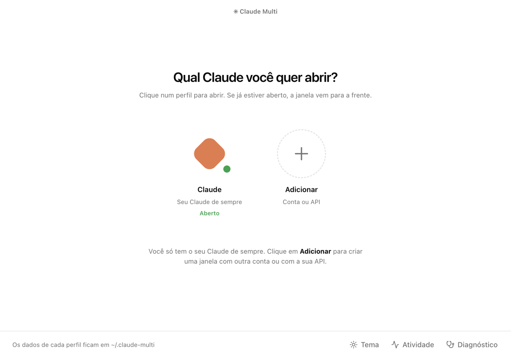
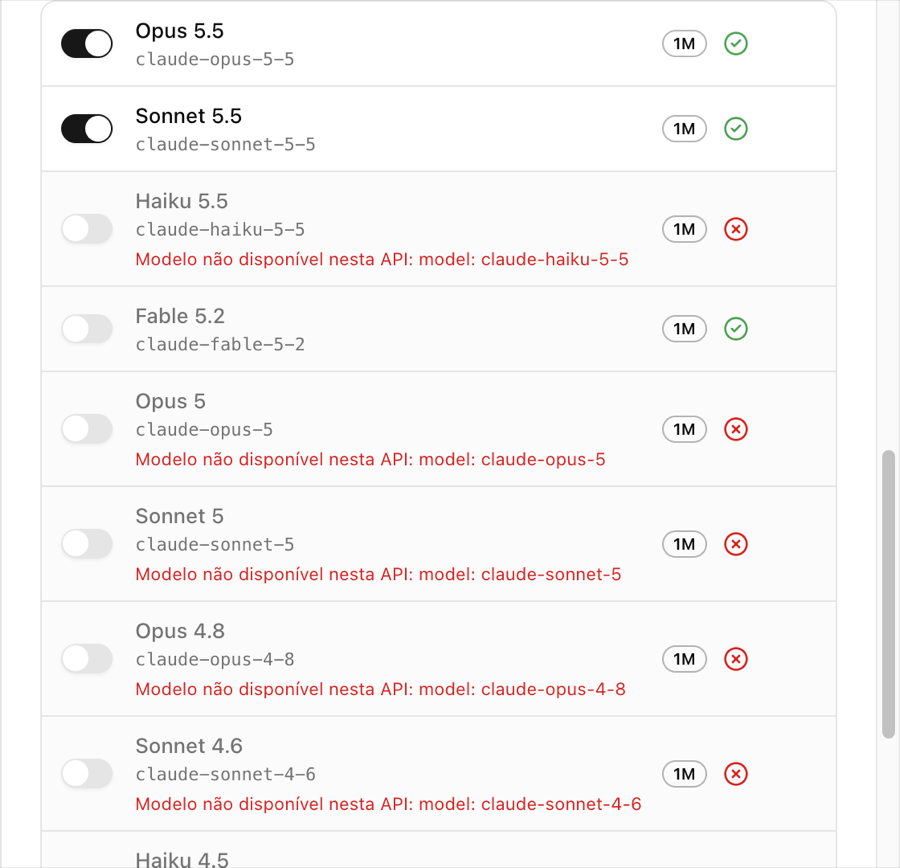

# Claude Multi para Mac

Abra várias janelas do **Claude Desktop** ao mesmo tempo no Mac, cada uma com a sua conta ou com a sua API, e escolha qual abrir numa tela de perfis no estilo do Chrome.

> Projeto da comunidade, **não oficial**. Não tem relação com a Anthropic. Usa comportamentos não documentados do Claude Desktop e pode parar de funcionar numa atualização dele.



## O que faz

- **Perfis:** cada perfil abre uma janela do Claude separada, com login, conversas e configurações próprios.
  - **Conta Claude:** outra conta de assinatura. Você faz o login dentro da janela.
  - **API própria:** um endpoint compatível com a API da Anthropic (a própria Anthropic, OpenRouter, um gateway da empresa…), com a sua chave.
- **Seu Claude de sempre** aparece na lista e abre normalmente. O app nunca mexe no login dele.
- **Modelos:** a lista já vem com os modelos atuais do Claude, cada um com um switch. O botão **Testar modelos com esta chave** manda um “oi” curto para cada modelo. Os que não respondem são marcados e desligados.
- **Saber qual janela é qual:** a janela em uso ganha uma borda na cor do perfil, com o nome em cima. Com a janela maximizada, a borda e o nome passam para dentro dela. A borda some no Mission Control.
- **Cor e formato** por perfil, **Atividade** (histórico do que o app fez, com o erro completo quando algo falha) e **Diagnóstico** (confere se o Mac tem tudo e avisa quando o Claude atualizou e um perfil precisa de uma cópia nova).
- Tema claro, escuro ou igual ao Mac. Interface em português.



## Instalar

Precisa de um Mac com Apple Silicon (M1 ou mais novo) e do [Claude Desktop](https://claude.ai/download) em `/Applications`.

1. Baixe `Claude-Multi-mac-arm64.zip` na página de [Releases](https://github.com/jhoued/claude-multi-mac/releases) e descompacte.
2. Arraste **Claude Multi.app** para a pasta Aplicativos.
3. O app não é assinado pela Apple, então o macOS bloqueia na primeira vez. Libere com:

   ```bash
   xattr -cr "/Applications/Claude Multi.app"
   ```

4. Abra o app. Se algo não funcionar, veja a tela **Diagnóstico**.

Também precisa do Python 3 do sistema (`/usr/bin/python3`). Se ele não existir, o macOS oferece instalar as Ferramentas de Linha de Comando do Xcode.

## Compilar a partir do código

Precisa de Node 20+ e das Ferramentas de Linha de Comando do Xcode (`xcode-select --install`).

```bash
git clone https://github.com/jhoued/claude-multi-mac
cd claude-multi-mac
npm install
npm run dev     # roda em modo de desenvolvimento
npm run dist    # gera dist/mac-arm64/Claude Multi.app e o .zip
npm test        # self-check do posicionamento da borda
```

## Como funciona

- **Janelas extras:** usa o script do projeto [claude-desktop-multiple-windows-different-api](https://github.com/TonF1917/claude-desktop-multiple-windows-different-api) (MIT), em `resources/claude-multi/`. Ele faz uma cópia do Claude.app para cada perfil (cópia APFS, quase não ocupa espaço), troca o ícone, assina localmente e abre com uma pasta de dados separada em `~/.claude-multi/<perfil>`.
  - Correção aplicada nessa cópia: o script original mudava o `CFBundleName` da cópia, e o Electron não achava os processos auxiliares (“Unable to find helper app”). A linha está marcada com `patched`.
- **Perfis de API:** o app grava a configuração da API em `~/.claude-multi/<perfil>/profile.json`. Só o seu usuário consegue ler esse arquivo.
- **Borda:** um helper em Swift (`helper/windowwatch.swift`) lê só a posição da janela da frente e o processo dono dela. Isso não precisa da permissão de Gravação de Tela. O app desenha uma janela transparente, que não recebe cliques, em volta da janela do perfil.
- **Interface:** Electron, React, Tailwind e [shadcn/ui](https://ui.shadcn.com).

## Limites conhecidos

- Só Apple Silicon por enquanto.
- O seu Claude de sempre não ganha uma cópia separada: ele abre como sempre.
- O compartilhamento de conversas entre janelas, que o projeto original tem, não está ligado nesta interface.
- Depois de uma atualização do Claude Desktop, a cópia de cada perfil fica desatualizada. Atualize pela tela **Diagnóstico**.

## Licença

MIT. O código em `resources/claude-multi/` é do projeto original, também MIT (veja `resources/claude-multi/LICENSE`).

---

**English:** a Mac app to run several Claude Desktop windows side by side, each with its own Claude account or its own Anthropic-compatible API key. It has a Chrome-style profile picker, a per-model key test, and a coloured border with the profile name around the window in use. The UI is in Portuguese. Unofficial and not affiliated with Anthropic.
